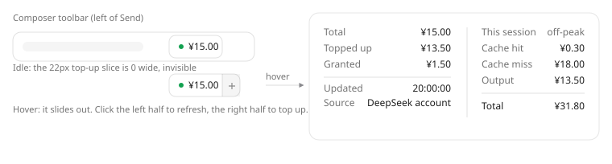

# dsh-web-api-balance

[](LICENSE)
[](https://github.com/topics/dsh-plugin)
[](https://github.com/deepseek-ai/deepseek-harness)


<!-- README-I18N:START -->

[中文](./README.md) | **English**

<!-- README-I18N:END -->

Shows your DeepSeek API balance inside the DeepSeek Harness web UI, and works out what the current
conversation has cost so far.



## Install

```sh
dsh plugin --profile web add dsh-web-api-balance@1.0.4
```

The version is pinned on purpose. To upgrade, name the new version and run it again — updating DSH
itself, or this repository, does not swap an installed plugin out from under you.

If npm is unreachable, the release carries the same tarball, byte for byte, just served from a
GitHub domain:

```sh
dsh plugin --profile web add https://github.com/Charaaah/dsh-web-api-balance/releases/download/v1.0.4/dsh-web-api-balance-1.0.4.tgz
```

From source also works. `dsh plugin` accepts a bare repository URL and the `github:owner/repo`
shorthand, and both run a GitHub connectivity check first. Everything after `#` is read by pnpm as a
git ref, so you can pin a commit:

```sh
dsh plugin --profile web add https://github.com/Charaaah/dsh-web-api-balance
dsh plugin --profile web add github:Charaaah/dsh-web-api-balance#<commit-sha>
```

Refresh the page and it is there. If you previously installed the **same version** with `link:` or
`file:`, a plain `add` will not replace it — pnpm sees the version already satisfied and skips — so
remove it first.

## Uninstall

```sh
dsh plugin --profile web remove dsh-web-api-balance
```

That forwards to pnpm inside the profile directory, so it drops the package and its dependency line.
It does not clean `dsh.profile.bundles`, which is a DSH field pnpm knows nothing about. Edit
`~/.dsh/profiles/web/package.json` and remove the name from the array yourself:

```jsonc
"dsh": { "profile": { "bundles": [
  "@deepseek-ai/dsh-base",
  "@deepseek-ai/dsh-web-app",
  "dshmarket"
  // delete this line: "dsh-web-api-balance"
] } }
```

Leaving it names a package that is no longer installed, which is a boot-time hazard. The market
page's plugin toggle does both steps for you; the command line does not.

An uninstall does not touch these, so clear them by hand if you want them gone:

- `DEEPSEEK_API_KEY` in `~/.dsh/.credentials.yaml`. That belongs to DSH's credential service and is
  the same entry the Models settings page writes, so you may still be using it elsewhere. The plugin
  neither creates nor deletes it.
- A hand-written `- id: dsh-web-api-balance` block in the profile's `cordis.patch.yml`. It is
  harmless once the package is gone, since a row whose package is absent is ignored, but it may hold
  an `apiKey`.
- The `localStorage` cache under the key `dsh-web-api-balance:last`, which holds amounts and a
  timestamp and no credential.

Published versions cannot be withdrawn — npm versions are immutable — so uninstalling is a local
action. `1.0.4` stays published and can be installed again at any time.

## The interface

There is one thing: a persistent chip on the composer toolbar, to the left of the send button,
showing the total balance. Hovering it, or focusing it from the keyboard, opens a panel with two
columns and a vertical rule between them:

```
Total       ¥15.00  │   This session        off-peak
Topped up   ¥13.50  │   Cache hit    1,000,000   ¥0.30
Granted      ¥1.50  │   Cache miss   2,000,000   ¥18.00
Updated   20:00:00  │   Output         500,000   ¥13.50
Source  DeepSeek account│  ────────────────────────────
                    │   Total                   ¥31.80
```

The left column is the account balance, the right is this conversation's cost. With no usage reported
yet the right column and the rule both disappear and the panel falls back to a single column. The two
columns are top-aligned, so the account column does not repeat the name already on the chip and does
not print the total twice; the total is simply its own "Total" row.

The chip itself is split in half, with no extra buttons and no text:

- The left half, a dot and the amount, refreshes the balance immediately when clicked.
- The right half, a 22px strip with a wallet-plus icon, is zero-width and invisible until the pointer
  enters the chip. Clicking it opens the top-up page in a new tab.

So at rest it is just a clean number. When the balance can't be read there is nothing to top up, so
the whole right half is not rendered, the chip turns red, and the panel states the reason.

The top-up address prefers `AccountView.links.topUpUrl` from the account service, so a deployment
pointing at an internal Platform sends you to its own site. Failing that it uses the public
`https://platform.deepseek.com/top_up`. The browser half has the same fallback built in, so the right
half works even when the host reports no address.

The balance comes from DeepSeek's own `GET https://api.deepseek.com/user/balance`, or from DSH's
account service when you are signed in.

## How the cost is worked out

The official token counts don't tell you what you spent, so the right column splits this session's
cumulative usage into money, one row per billing bucket, with a total at the end:

| Row | Source |
|---|---|
| Cache hit | `tokenUsage.cacheReadTokens` |
| Cache miss | `tokenUsage.uncachedInputTokens` + `cacheWriteTokens` |
| Output | `tokenUsage.outputTokens` |
| Total | the three above |

The official schema has `prompt_tokens = prompt_cache_hit_tokens + prompt_cache_miss_tokens`, so
those three rows cover every billable token. Caching itself costs nothing extra: writing, storing and
expiring the cache never appear on the bill, only the tokens, priced in those three tiers.

The numbers come from DSH's session projection — the usage the host folds out of the whole session
log from what the provider reported, not an estimate. The model rate is looked up from the current
route in `useProjection('modelSelection')`. Both projections are pushed by the host, so the panel
updates as soon as usage is reported, with no extra request and nothing sent anywhere.

Two things about pricing need saying.

First, the rates are hardcoded in `PRICING` inside `client.js`, in CNY per million tokens, so an
official price change means editing that one object. A model that is not in the table is not guessed
at: the exact token counts still appear, and the amount reads "price not listed for this model". The
retired ids `deepseek-v4-flash` and `deepseek-v4-flash-vision-exp` are billed as `deepseek-flash`, per
the official notice.

Second, peak and off-peak. The name to the right of the column heading is the tariff currently in
effect: Beijing-time weekdays 09:00–12:00 and 14:00–18:00 read "梁文峰", everything else "梁文谷", which
is half price. The decision is made at render time from the clock, converting the instant to UTC+8
before reading it, so the browser's own timezone makes no difference. Official exemptions for Chinese
public holidays are not modelled — the plugin ships no holiday calendar — so a weekday holiday reads
"梁文峰" and overstates the price. Cumulative usage also carries no per-request timestamp, so a session
spanning a tariff change cannot honestly be assigned to one tier; the name means "the tariff a request
sent right now would pay".

Three more things about the figures:

flash and pro are not the same price. The rate is read from the modelSelection projection, and the
table keeps the two apart (hit ¥0.04 / ¥0.30, miss ¥2 / ¥9, output ¥8 / ¥27, all peak rates). A route
matches whether or not it carries a `deepseek-official/` prefix. `next` outranks `lastUsed`, so a model
you just picked in the selector, which the next request will use, is the one shown.

The numbers are this session's cumulative usage. They exclude subagents, which are separate sessions
with their own usage, and they are not your account's historical bill. For account-wide spend, use the
official platform's usage page.

Cumulative usage is one total per session and does not record which model was used for which part. So
if a session switched from flash to pro partway through, what you see is the whole session priced at
the current model's rate: accurate if nothing changed, an estimate if something did. Switching
sessions remounts the component, and usage is folded by the host per session log, so nothing bleeds
across.

## Credentials

Usually there is nothing to fill in. The host resolves credentials in this order, and neither route
needs you to type anything:

1. Account grant, `deepseekAccount.getBalance`. The OAuth grant written when you sign in to DeepSeek
   under Settings → Account. No API key exists on this route at all.
2. A stored API key. `config.apiKey` wins if set; otherwise the credential-service reference named by
   `config.apiKeyEnv`, default `DEEPSEEK_API_KEY`. That is the very entry the DeepSeek key in
   Settings → Models writes to `~/.dsh/.credentials.yaml`, so if you configured a key before, the
   plugin simply reads it. A same-named variable in the launching process environment also works.

With neither present the chip reads "balance unavailable" and the panel gives the specific reason
rather than failing silently. The panel footer notes which route the numbers came from
(`DeepSeek account` or `API key`).

Why a host-side half is necessary at all: the balance endpoint sends no CORS headers, and an API key
must never reach browser code. So `host.js` holds the credential, makes the request and caches the
result, exposing a JSON summary at `/plugins/dsh-web-api-balance/balance` (`?refresh=1` forces a live
query), and `client.js` just fetches that same-origin route. The route requires the `dsh web` session
token and goes through the same authentication as every other request the page makes.

## Configuration

Configuration lives in the web profile's `cordis.patch.yml`, on the `id: dsh-web-api-balance` row. It
works unconfigured; you only need this to override a default:

```yaml
- id: dsh-web-api-balance
  disabled: false
  inject: [webServer]
  config:
    apiKey: ''                       # set sk-... to name a key explicitly (highest priority)
    apiKeyEnv: DEEPSEEK_API_KEY      # otherwise this credential reference / environment name
    baseURL: https://api.deepseek.com
    refreshSeconds: 300              # cache window, 30-86400 seconds
```

Resolution is account grant → `config.apiKey` → the credential service's `apiKeyEnv` → a same-named
environment variable, first hit wins.

## Behaviour and limits

The host caches for `refreshSeconds` and concurrent reads share one upstream call. The account-grant
route goes through DSH's own service and makes no external HTTP request; when it reports `null` for a
signed-out account the API-key route takes over. The browser refreshes every five minutes, and
clicking the chip refreshes immediately. The last successful summary is stored in `localStorage`, so a
page reload shows the old value before updating. An upstream 401 or 403 is classified as an invalid
key and not retried in a loop.

The panel renders only while hovered or focused and does not occupy space otherwise; it also sets
`pointer-events: none` so it never blocks a click. The "this session" column appears only once the
host has reported usage, so a new session with no messages yet renders neither the column nor the
rule. Amounts keep two decimals, except a bucket under one fen, which keeps three so it does not read
`¥0.00`. Styling uses host theme tokens only (`--dsw-alias-*`), so light and dark both follow.

The JSON shape the route returns, which is what the browser half renders:

```jsonc
{
  "ok": true,
  "source": "account" | "api-key",  // which credential route these numbers came from
  "topUpUrl": "https://platform.deepseek.com/top_up",
  "available": true,                 // upstream is_available; false means the balance is exhausted
  "total": 15, "toppedUp": 13.5, "granted": 1.5,
  "currency": "CNY",
  "checkedAt": 1791587145212
}
// on failure: { "ok": false, "reason": "...", "message": "...", "checkedAt": ... }
```

## Privacy

The package contains no credential and sends nothing anywhere. There is no API key literal in the
code; a key is read at runtime from the plugin config, the credential service
(`~/.dsh/.credentials.yaml`, maintained by DSH) or the launching process environment. Its only
destination is the `Authorization: Bearer` header aimed at the balance endpoint itself, by default
`api.deepseek.com`. No telemetry, no logging of it, no third-party request. It is never sent to the
browser either; the browser half only reads a few numbers from a local same-origin route, and the only
thing it writes locally is the balance summary in `localStorage` (amounts and a timestamp).

The package holds 14 files: `LICENSE`, `README.md`, `README.en.md`, `client.js`, `cordis.patch.yml`,
`host.js`, `icon.svg`, `index.js`, `locale/{en,zh}.json`, `package.json`, `release.json` and
`assets/preview{,.en}.svg`. The two test scripts, the build scripts, any profile state and any
credential are not among them. The release tarball and the npm tarball come from the same
`npm pack` command, so the two install routes deliver identical bytes rather than bytes that ought to
match.

## Development

Two scripts live in the repository and depend only on the Node standard library, with no need for the
profile's `node_modules`:

```sh
node smoke-test.mjs   # browser half
node host-test.mjs    # host half
```

`smoke-test.mjs` loads `client.js` against a stubbed module loader and a stateful React shim, asserts
slot registration and dictionary resolution, and drives the chip through failure → hover → successful
refresh → full detail. It also asserts that the right half does not render without a balance, that
clicking it with a balance opens the correct URL, the fallback when the host reports no address, and
the cost column: absent without usage, with the three buckets' token counts and amounts matching
`deepseek-v4-pro` peak rates, a correct total, no amount for an unknown model, and alias pricing for
retired model names.

`host-test.mjs` starts a fake DeepSeek `/user/balance` endpoint and mounts the plugin's route on real
HTTP, covering a cache hit, a forced refresh, 401, environment fallback, no credential, the account
grant taking precedence, the fallback to a stored key when signed out, and the top-up address.

The publishing scripts are under `publish/` and are likewise not shipped in the package. This machine
has no git, so pushing goes through the GitHub REST API in four steps — blob, tree, commit, ref — and
finishes by reading the repository back to verify:

```powershell
node publish/build-repo.mjs --owner Charaaah   # writes publish/repo/, adds public metadata and release.json
node publish/pack-npm.mjs                      # npm pack --ignore-scripts; this is the artifact that ships
$env:DSH_GH_TOKEN = '<token>'                  # session only, never written to disk
node publish/push-github.mjs --dry-run         # inspect the plan first
node publish/push-github.mjs
node publish/release-github.mjs                # tags, creates the release, uploads the tarball
$env:NPM_TOKEN = '<token>'
node publish/publish-npm.mjs                   # publishes the tarball that was already packed
```

MIT licensed.
