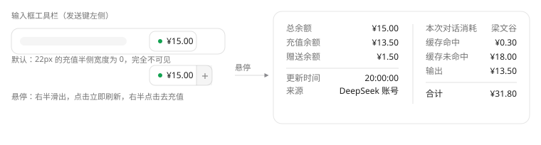

# dsh-web-api-balance

[](LICENSE)
[](https://github.com/topics/dsh-plugin)
[](https://github.com/deepseek-ai/deepseek-harness)


<!-- README-I18N:START -->

**中文** | [English](./README.en.md)

<!-- README-I18N:END -->

在 DeepSeek Harness 的 Web 界面里显示 DeepSeek API 余额，顺便算一下当前这条对话花了多少钱。



## 安装

```sh
dsh plugin --profile web add dsh-web-api-balance@1.0.5
```

版本号建议钉死，升级时手动改。DSH 升级、或者这个仓库更新，都不会顺手把你装的插件换掉，这点是故意的。

npm 连不上就从 Release 装，同一个文件：

```sh
dsh plugin --profile web add https://github.com/Charaaah/dsh-web-api-balance/releases/download/v1.0.5/dsh-web-api-balance-1.0.5.tgz
```

从源码装也可以。`dsh plugin` 认仓库 URL 和 `github:owner/repo` 简写（会先探一次 GitHub 连通性），
`#` 后面会被 pnpm 当 git ref，所以能钉到 commit：

```sh
dsh plugin --profile web add https://github.com/Charaaah/dsh-web-api-balance
dsh plugin --profile web add github:Charaaah/dsh-web-api-balance#<commit-sha>
```

装完刷一下页面。如果你之前用 `link:` 或 `file:` 装过同一个版本号，直接 `add` 不会替换它，pnpm 会认为
版本已满足然后跳过，得先 remove。

## 卸载

```sh
dsh plugin --profile web remove dsh-web-api-balance
```

这条是转发给 profile 目录里的 pnpm，所以会卸掉包和 `package.json` 里那行依赖。`dsh.profile.bundles`
不会跟着清。那是 DSH 的字段，pnpm 不认识，得自己编辑 `~/.dsh/profiles/web/package.json` 把包名删掉：

```jsonc
"dsh": { "profile": { "bundles": [
  "@deepseek-ai/dsh-base",
  "@deepseek-ai/dsh-web-app",
  "dshmarket"
  // 删掉这行："dsh-web-api-balance"
] } }
```

留着会指向一个不存在的包，启动时会报。市场页面的插件开关会帮你把这两步一起做，命令行不会。

下面几样卸载不管，需要的话自己清：

- `~/.dsh/.credentials.yaml` 里的 `DEEPSEEK_API_KEY`。这是 DSH 凭证服务的条目，「设置 → 模型」写进去的
  也是同一个，你可能在别处还在用，所以插件不动它。
- profile 的 `cordis.patch.yml` 里手工写的那段 `- id: dsh-web-api-balance`。包没了以后这行会被忽略，
  但里面可能写着 `apiKey`。
- `localStorage` 的 `dsh-web-api-balance:last`，存的是金额和时间戳，没有凭证。

npm 上的版本删不掉（版本号不可变），所以卸载只影响本机，想装回来随时 `add` 一次就行。

## 界面

只有一处 UI：输入框工具栏、发送键左边的常驻胶囊，显示总余额。鼠标移上去（或者键盘聚焦）弹出浮层，
左右两栏，中间一条竖线：

```
总余额      ¥15.00  │   本次对话消耗     梁文谷
充值余额    ¥13.50  │   缓存命中    1,000,000   ¥0.30
赠送余额     ¥1.50  │   缓存未命中  2,000,000   ¥18.00
更新时间    20:00:00│   输出          500,000   ¥13.50
来源        DeepSeek 账号│   ────────────────────────────
                    │   合计                    ¥31.80
```

左栏是账户余额，右栏是这条会话的消耗。没有用量报告时右栏和竖线一起消失，只剩单栏。两栏顶部对齐，
账户栏不必重复胶囊上已经有的名字，也没单独再打一遍总额，总额就是「总余额」那行。

胶囊本身切成两半，没有额外按钮也没有文字：

- 左半边是圆点加金额，点一下立即刷新。
- 右半边是一条 22px 的竖条加钱包加号图标，平时宽度 0、完全看不见，鼠标进胶囊才滑出来，点击在新标签页
  打开充值页。

静止状态下它就是个干净的数字。取不到余额时也没有金额可充，整个右半边不渲染，胶囊变红，浮层里写明
原因。

充值地址优先用账号服务给的 `AccountView.links.topUpUrl`，这样指向内部 Platform 的部署会跳自己的站点；
拿不到就用公开的 `https://platform.deepseek.com/top_up`。浏览器半侧内置了同一个兜底，宿主没报告
地址时右半边也能用。

余额走 DeepSeek 官方的 `GET https://api.deepseek.com/user/balance`，登录了账号时走 DSH 自己的账号服务。

## 消耗怎么算的

官方的 token 计数看不出花了多少钱，右栏就把这条会话的累计用量按人民币拆开，三个计费桶各一行：

| 行 | 取数 |
|---|---|
| 缓存命中 | `tokenUsage.cacheReadTokens` |
| 缓存未命中 | `tokenUsage.uncachedInputTokens` + `cacheWriteTokens` |
| 输出 | `tokenUsage.outputTokens` |
| 合计 | 上面三项之和 |

官方 schema 里 `prompt_tokens = prompt_cache_hit_tokens + prompt_cache_miss_tokens`，这三行能覆盖全部
计费 token。缓存本身不额外收费，落盘、存储、过期都不进账单，只有 token 按这三档计价。

用量是宿主从整条会话日志折出来的官方回报值，价格则按 `useProjection('modelSelection')` 里的当前路由查表。
两个投影都是宿主推的，有回报就更新，不用额外请求，也不往外发数据。

价格表是写死的，在 `client.js` 的 `PRICING` 里，单位元每百万 tokens。官方调价了改这一个对象。表里没有的
模型不猜，照样显示 token 数，金额位置写「未收录该模型价格」。旧名字 `deepseek-v4-flash` 和
`deepseek-v4-flash-vision-exp` 按官方说明归到 `deepseek-flash`。

峰谷这块容易看错，多说两句。右栏标题右边那个名字就是当前档位：北京时间工作日 9:00–12:00 和 14:00–18:00
显示「梁文峰」，其余时间「梁文谷」，后者半价。判断是拿当前时刻先算成 UTC+8 再读时钟，浏览器在哪个
时区都一样。

两个已知的坑：一是我没做节假日，插件不带日历，法定假日的工作日会显示梁文峰、把价格算高。二是累计用量里
没有每次请求的时间戳，跨了峰谷的会话没法归到某一档，这个名字的意思只是「此刻发请求按哪档价」。

另外，flash 和 pro 不是一个价。单价从 modelSelection 投影的当前路由查，表里两套价分开（命中 ¥0.04 / ¥0.30，
未命中 ¥2 / ¥9，输出 ¥8 / ¥27，都是高峰价）。路由带不带 `deepseek-official/` 前缀都能对上。`next` 优先于
`lastUsed`，你刚在模型选择器里改过、下次请求才用的那个，显示的就是它。

数字是当前会话的累计，不含子代理（它们各自是独立会话），也不是账号的历史账单。要看账号侧的消耗去官方
平台的用量页。

还有一点：累计用量是一条会话一个总数，里面没记哪段用了哪个模型。一条会话中途从 flash 换成 pro，
整条会按当前模型的单价算。换过就是估值，没换过就是准的。会话切换时组件会重挂，用量是按每条会话的
日志分别折的，不会串。

## 凭证

一般不用填。宿主按这个顺序取，两条路都不用你手输：

1. 账号授权（`deepseekAccount.getBalance`）。就是「设置 → 账号」登录 DeepSeek 之后写入的那个 OAuth 授权，
   这条路上没有 API Key。
2. 已保存的 API Key。`config.apiKey` 优先，留空就去凭证服务里找 `config.apiKeyEnv` 指定的引用，默认
   `DEEPSEEK_API_KEY`。这跟「设置 → 模型」填 DeepSeek key 时写进 `~/.dsh/.credentials.yaml` 的是同一个
   条目，早就配过 key 的话直接就能读；启动 dsh 的进程环境里有同名变量也行。

两条都没有时胶囊显示「余额不可用」，浮层写具体原因，不会静默失败。浮层底部会标这次数字来自哪条路。

宿主半侧为什么必须有：余额接口不带 CORS 头，而且 API Key 不能进浏览器。`host.js` 因此拿着凭证发请求、
缓存结果，在 `/plugins/dsh-web-api-balance/balance` 上出一份 JSON（`?refresh=1` 强制实时查），`client.js`
只 fetch 这个同源路由。路由和页面其它请求走同一套会话令牌鉴权。

## 配置

写在 web profile 的 `cordis.patch.yml` 里 `id: dsh-web-api-balance` 那行。不配也能用：

```yaml
- id: dsh-web-api-balance
  disabled: false
  inject: [webServer]
  config:
    apiKey: ''                       # 单独指定 key 时填 sk-...（优先级最高）
    apiKeyEnv: DEEPSEEK_API_KEY      # 否则用这个凭证引用 / 环境变量名
    baseURL: https://api.deepseek.com
    refreshSeconds: 300              # 缓存窗口，30-86400 秒
```

顺序是账号授权 → `config.apiKey` → 凭证服务的 `apiKeyEnv` → 同名环境变量，谁先命中用谁。

## 行为和边界

宿主按 `refreshSeconds` 缓存，并发的读共用一次上游调用。账号授权那条走 DSH 自己的服务、不发外部 HTTP；
未登录（返回 `null`）时落到 API Key 那条。浏览器每 5 分钟自动刷一次，点胶囊立即刷。最近一次成功的摘要
存进 `localStorage`，页面刷新先显示旧值再更新。上游返 401/403 归为「key 无效」，不反复重试。

浮层只在悬停或聚焦时渲染，平时不占位，设了 `pointer-events: none` 不会挡住点击。「本次对话消耗」那栏
只在宿主报告过用量之后出现，新会话什么都没发时整栏连同竖线都不渲染。金额留两位小数，不够一分的留三位，
免得显示成 `¥0.00`。样式只用宿主主题令牌（`--dsw-alias-*`），浅色深色都跟随。

路由返回的 JSON 就是浏览器半侧渲染用的：

```jsonc
{
  "ok": true,
  "source": "account" | "api-key",  // 这次数字来自哪条凭证路
  "topUpUrl": "https://platform.deepseek.com/top_up",
  "available": true,                 // 上游 is_available；false 表示余额已耗尽
  "total": 15, "toppedUp": 13.5, "granted": 1.5,
  "currency": "CNY",
  "checkedAt": 1791587145212
}
// 失败时：{ "ok": false, "reason": "...", "message": "...", "checkedAt": ... }
```

## 隐私

包里没有凭证，也不往任何地方回传数据。代码里没有 API Key 字面量，key 只在运行时从插件配置、凭证服务
（`~/.dsh/.credentials.yaml`，DSH 自己维护）或启动进程的环境变量里读。它唯一的去处是 `Authorization:
Bearer` 头，目标就是余额接口本身（默认 `api.deepseek.com`），没有遥测、没有日志打印、没有第三方请求。
key 也不进浏览器，浏览器半侧只读同源路由返回的几个数字，唯一写本地的是 `localStorage` 里的余额摘要。

打包出来 14 个文件（`LICENSE`、`README.md`、`README.en.md`、`client.js`、`cordis.patch.yml`、`host.js`、
`icon.svg`、`index.js`、`locale/{en,zh}.json`、`package.json`、`release.json`、`assets/preview{,.en}.svg`），
两个测试脚本、构建脚本、任何 profile 状态和任何凭证都不在里面。Release 上的 tarball 和 npm 上的是同一条
`npm pack` 命令打出来的，两条安装路径装到的是同一份字节。

## 开发

两个脚本，只依赖 Node 标准库，不需要 profile 的 node_modules：

```sh
node smoke-test.mjs   # 浏览器半侧
node host-test.mjs    # 宿主半侧
```

`smoke-test.mjs` 用桩模块加载器和带状态的 React 垫片加载 `client.js`，验槽位注册和字典解析，驱动胶囊走
「失败 → 悬停展开 → 点击刷新成功 → 明细齐全」，另外验右半边在无余额时不渲染、有余额时点击用正确的 URL
新开标签页、宿主没给地址时的兜底，以及消耗栏：没有用量时不渲染、三个桶的 token 数与金额逐项对上
`deepseek-v4-pro` 高峰价、合计正确、未知模型只报 token 不报金额、旧模型名走别名价。

`host-test.mjs` 起一个假的 DeepSeek `/user/balance`，把插件的路由挂到真实 HTTP 上跑通缓存命中、强制刷新、
401、环境变量回退、无凭证、账号授权优先、未登录回退到已存 key，以及充值地址。

发布脚本在 `publish/` 下，也不随包发布。这台机器没有 git，所以推仓库是走 GitHub REST API 的
blob → tree → commit → ref 四步，最后读回来校验：

```powershell
node publish/build-repo.mjs --owner Charaaah   # 生成 publish/repo/，补公开元数据和 release.json
node publish/pack-npm.mjs                      # npm pack --ignore-scripts，产物即发 npm 的那份
$env:DSH_GH_TOKEN = '<token>'                  # 只在当前会话里，不落盘
node publish/push-github.mjs --dry-run         # 先看计划
node publish/push-github.mjs
node publish/release-github.mjs                # 打 tag、建 Release、挂 tarball
$env:NPM_TOKEN = '<token>'
node publish/publish-npm.mjs                   # 发的是已打包好的那一份
```
